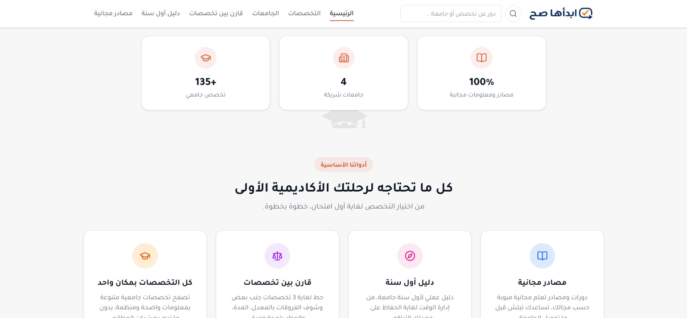
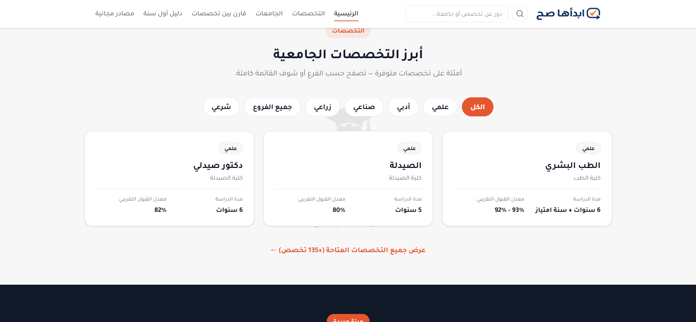
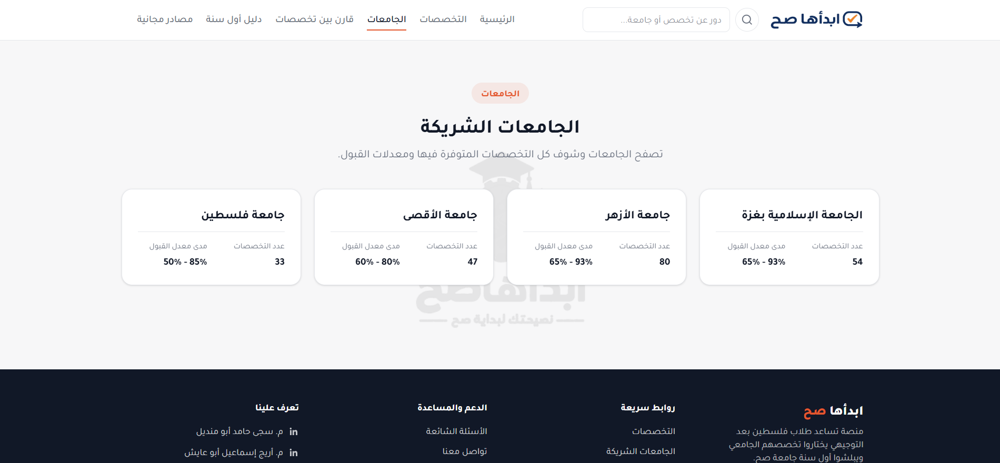
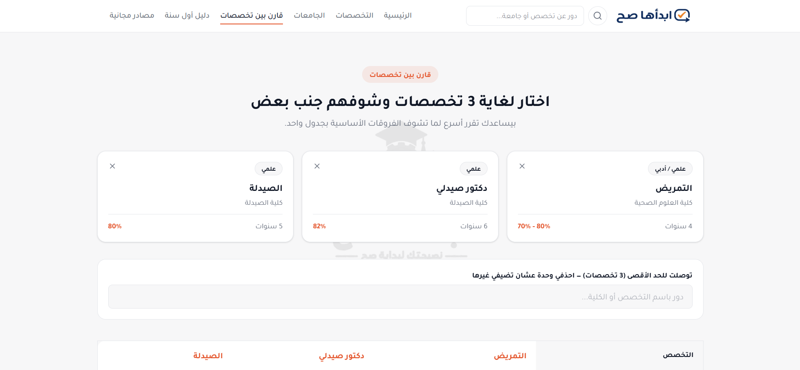
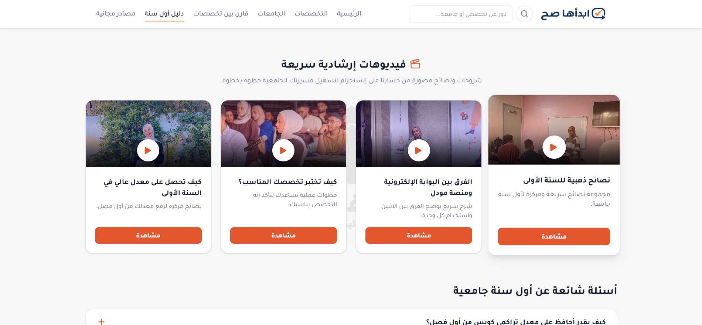

<h1 align="center">ابدأها صح · Start It Right</h1>

<p align="center">
  <b>Helping Palestinian high-school graduates choose the right university major — with clear, accurate admission data.</b>
</p>

<p align="center">
  <a href="https://start-it-right1.vercel.app"></a>
  
  
  
</p>

<p align="center">
  
</p>

---

## The problem

Every year, thousands of students in Palestine finish Tawjihi and have to pick a university major in a few weeks. The information they need — which universities offer the major, the minimum admission average, what the major actually involves — is scattered across many websites and PDFs, and is often out of date.

## The solution

**Start It Right** puts that information in one place, in Arabic, in a format students can compare side by side. It currently covers **135+ majors across 4 universities** in Gaza.

The project grew out of **«ابدأها صح»**, my content series that has helped **30,000+ students** with study skills, time management and choosing their path.

## Features

- 📚 **Major pages** — faculty, track, duration, admission averages, first-year subjects, skills you need, skills to start learning now, career paths, related majors, and a quote from a real student
- ⚖️ **Compare majors** side by side — difficulty, market demand and core subjects (shown as "coming soon" until a reliable source confirms the data)
- 🏛️ **University pages** — generated automatically from the majors data, so they always stay in sync
- ✅ **Honest data** — any admission average not yet officially confirmed is clearly labeled as approximate
- 🧭 **First-year guide & FAQ** — practical advice for starting university the right way
- 🔗 **Resources** — curated links to help students prepare
- 🇵🇸 **Arabic, fully RTL**, written in simple Palestinian dialect, and responsive on phones

## Screenshots

| Majors | Universities |
|---|---|
|  |  |
| **Compare majors** | **First-year guide** |
|  |  |

## Tech stack

| Part | Technology |
|---|---|
| Frontend | React 19, Vite, React Router |
| Styling | Tailwind CSS v4 with a shared design-token theme |
| Data | Static JSON (no backend), built and validated with a Python script (`scripts/build_majors.py`) |
| Quality | Oxlint |
| Deployment | Vercel |

## Project structure

```
src/
├── pages/       # one file per route
├── components/  # reusable UI (cards, header, footer, student quote…)
├── data/        # all site content as JSON (majors, guide, FAQ, resources)
├── context/     # shared state, e.g. the "compare majors" list
└── utils/       # pure helpers (GPA summary, deriving universities)
```

## Run it locally

```bash
git clone https://github.com/sajahamad/start-it-right.git
cd start-it-right
npm install
npm run dev
```

## Roadmap

- [ ] Complete difficulty, market-demand and core-subject data for every major
- [ ] Verify all admission averages against official sources each year
- [ ] Add more majors and universities

## Author

**Saja Hamed Abu Mandeel** — Frontend Developer · Computer Systems Engineering, Al-Azhar University – Gaza

[Portfolio](https://saja-hamed-portfolio.vercel.app) · [LinkedIn](https://www.linkedin.com/in/saja-hamad-dev/) · [GitHub](https://github.com/sajahamad) · [Instagram](https://www.instagram.com/saja._hamed)

---

<p align="center"><i>If this project helped you, give it a ⭐ — it helps more students find it.</i></p>
